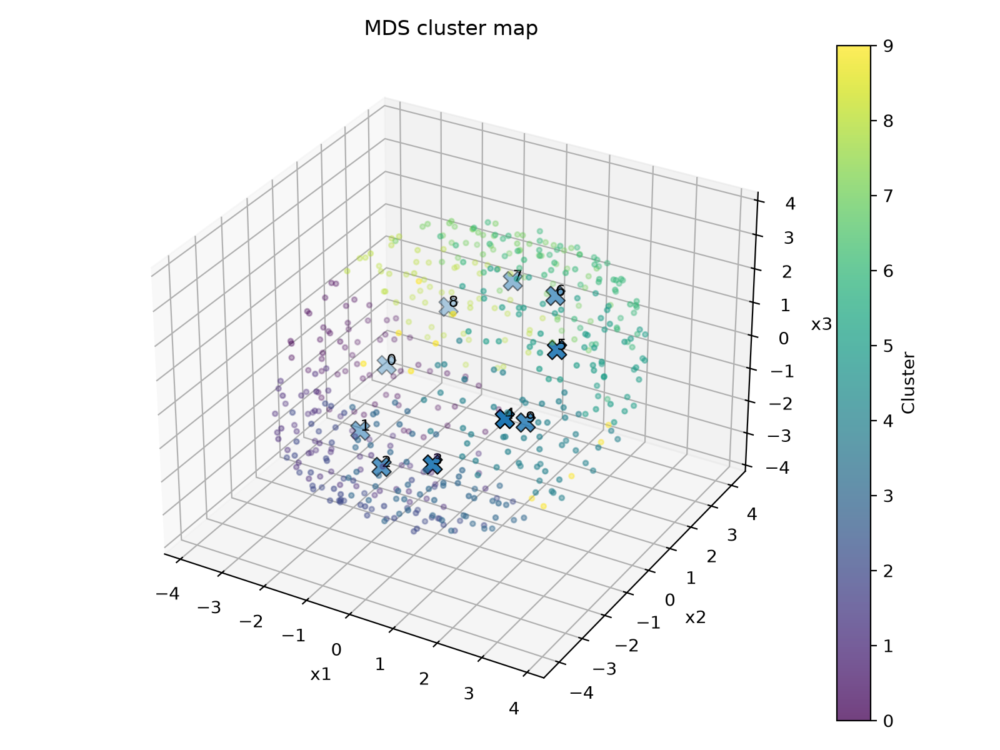
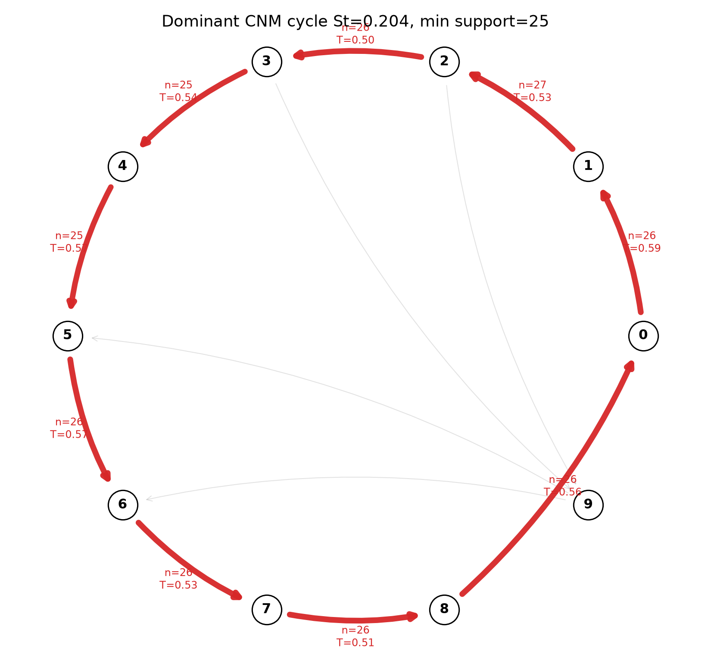
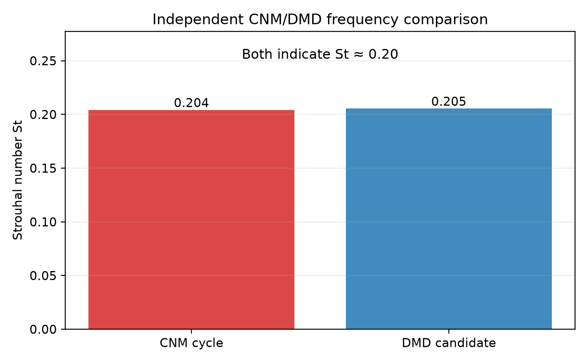

# Reference LES results

These figures and summaries come from the volume-weighted reference analysis
of the cylinder-wake LES at `Re_D approx 3900`, using `t=140...270`, `dt=0.25`,
521 snapshots, 200 retained POD coefficients, and `K=10` clusters. The retained
basis contains about 99.71% of the volume-weighted fluctuation energy.

| Diagnostic | Reference value |
|---|---:|
| dominant CNM cycle period | 4.89846 |
| CNM Strouhal number | 0.204146 |
| minimum direct-transition support on that cycle | 25 |
| independently ranked DMD candidate, amplitude rank 2 | 0.205403 |
| DMD candidate growth rate | -0.006635 |
| deterministic occupation L1 error | 0.065259 |
| probabilistic occupation L1 error, 200 runs | 0.010768 |

The frequencies agree to about 0.62%. Both analyses use the same training
window, so this is a consistency diagnostic rather than out-of-sample
validation or a calibrated uncertainty estimate.

MDS visualizes the reduced state space; it does not change the clustering.

Red edges show the dominant supported cycle; gray edges show other observed
direct transitions. Labels give observed counts and mean transition times.

The machine-readable reference outputs are
[`cnm_summary.json`](cnm_summary.json),
[`dmd_summary.json`](dmd_summary.json), and
[`network_cycles.json`](network_cycles.json).

These files were copied unchanged from the existing
`data/figures/final_release_volume_t140_270_K10/` run generated on 2026-08-20.
Their JSON provenance retains the original generation timestamp and source
commit `c8f9e7874be6d7aac4a9cd82b0292e12a62d8d73`; it does not describe a newly
computed simulation. The large input POD archive was fingerprinted by size and
modification time, with its SHA-256 skipped by the original size limit.

The CFD fields, VTK snapshots, spatial POD archive, and working arrays are not
included. To regenerate them, follow the [OpenFOAM instructions](../../openfoam/README.md)
and [reference analysis commands](../../README.md#reproducing-the-final-analysis).
To try the tools without a simulation, use the
[synthetic quickstart](../../examples/README.md).
